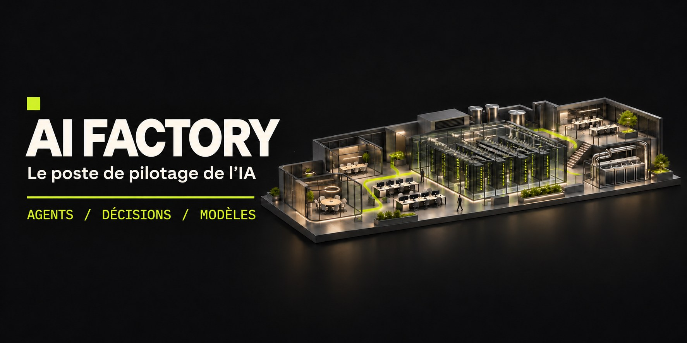
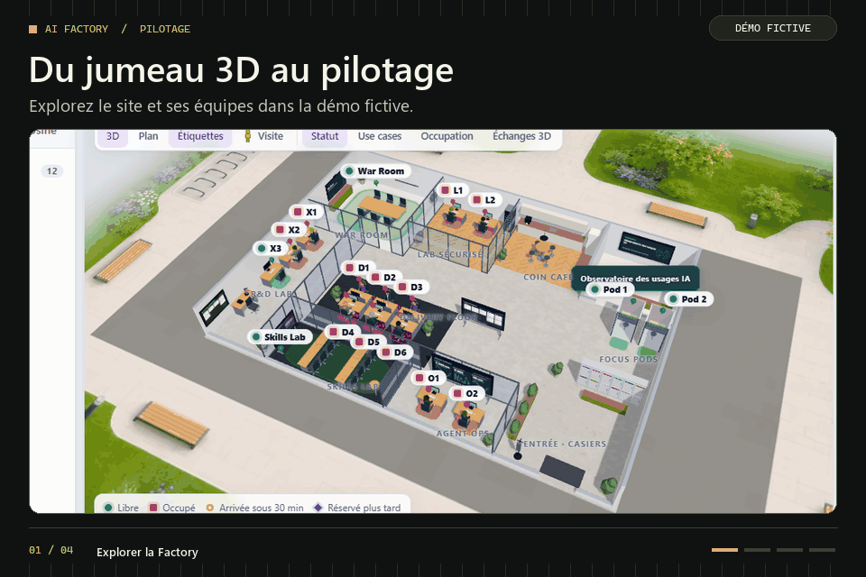
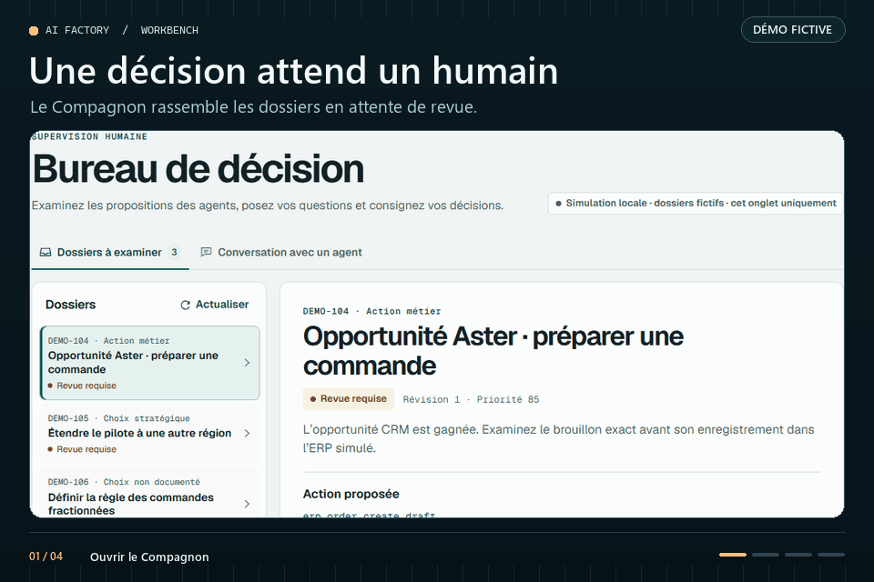
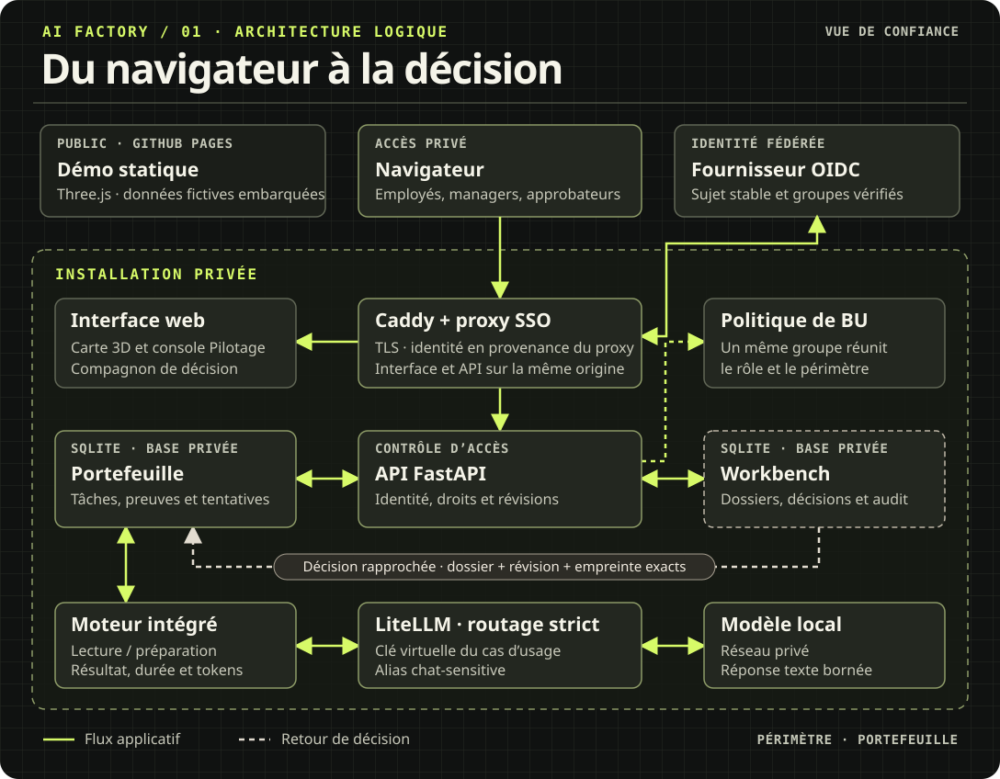

# Virtual AI Factory

[English](README.md) · **Français** · [Licence MIT](LICENSE) · [État de la CI](https://github.com/alebgl77/ai-factory/actions/workflows/ci.yml)

**Un jumeau numérique open source pour exploiter l’IA en entreprise.**

Suivez le travail des personnes et des agents, examinez les décisions avec leurs preuves et
consultez le routage des modèles et le coût des tokens depuis un espace de travail en 3D. Le
dépôt propose une démo dans le navigateur et une pile auto-hébergée pour les pilotes privés.

**[Ouvrir la démo 3D](https://alebgl77.github.io/ai-factory/?lang=fr)** · [Documentation](docs/fr/README.md) · [Installer](#démarrage-local-sans-aucune-clé) · [Architecture](docs/fr/ARCHITECTURE.md) · [Technologies](#pile-technologique)



| Explorer la démo publique | À essayer |
|---|---|
| **Agents** | Ouvrez **Projets et tâches** dans la [démo 3D](https://alebgl77.github.io/ai-factory/?lang=fr). Dépliez une tâche pour suivre le travail délégué et sa consommation de tokens. |
| **Décisions** | Examinez un brouillon ERP fictif dans le [Compagnon de décision](https://alebgl77.github.io/ai-factory/companion/index.html?lang=fr&demo_case=DEMO-104&demo_revision=1). Saisissez un motif et retrouvez le reçu simulé dans l’historique. |
| **Modèles** | Lancez un scénario de routage dans le [Laboratoire de flux](https://alebgl77.github.io/ai-factory/docs/flow-lab.html?lang=fr) et consultez les estimations de tokens et de latence. |

La démo utilise des données fictives dans le navigateur et fonctionne sans clé fournisseur. [Guide visuel des cinq circuits](https://alebgl77.github.io/ai-factory/docs/index.html#visual-tour)

**Pilote privé.** Configurez le SSO et les politiques par BU, connectez les modèles autorisés et recueillez les preuves d’exploitation auprès des producteurs habilités. [Compose](docs/DEPLOYMENT.md) · [Kubernetes](docs/fr/KUBERNETES.md)

<a id="technologies"></a>

## Pile technologique

### Pile de référence

| Couche | Technologies et rôles |
|---|---|
| **Interface et API** |  **Three.js** pour le jumeau 3D ·  **FastAPI** pour l’API d’agrégation |
| **Déploiement et routage** | **Docker Compose** pour la pile de référence ·  **Kubernetes** et  **Helm** pour le déploiement sur cluster ·  **Caddy** pour le proxy d’entrée · **LiteLLM** pour le routage des modèles |
| **Observabilité** |  **Prometheus** pour les métriques · **Grafana** pour les tableaux de bord · **Loki** pour les journaux ·  **Langfuse** pour les traces de modèles |
| **Recherche** |  **Qdrant** pour le stockage vectoriel et la télémétrie des collections dans la pile de référence Compose |

Le déploiement Helm utilise les services de modèles et de télémétrie gérés par l’exploitant. Le [comparatif des environnements](docs/fr/README.md#choisir-un-environnement) précise ce que contient chaque installation.

### Intégrations facultatives

| Intégration | Périmètre |
|---|---|
| **Serveurs de modèles** |  **vLLM** pour l’inférence sur GPU local ·  **Ollama** pour le profil VPS sur CPU. [Placement des modèles](#placement-des-modèles-sous-compose) |
| **Outils agents** |  **MCP** en local sur stdio pour le Workbench adaptatif. [Configuration MCP](docs/fr/ADAPTIVE_WORKBENCH.md#connecter-un-client-mcp) |
| **CRM** | **Salesforce**, **HubSpot** et  **Twenty** pour lire les opportunités et les entreprises. [Configuration CRM](docs/fr/ADAPTIVE_WORKBENCH.md#connecter-salesforce-hubspot-ou-twenty) |
| **ERP** | **Odoo** via une sonde en lecture seule. La création d’un brouillon dans l’ERP réel exige un adaptateur fourni par l’exploitant et son propre circuit de validation. [Adaptateur ERP](docs/fr/ADAPTIVE_WORKBENCH.md#brancher-un-adaptateur-de-brouillons-erp) |
| **Gouvernance des usages** | **Open Shadow AI** fonctionne séparément. Le pont opérateur importe les agrégats dans l’Observatoire. [Configuration de l’Observatoire](docs/SHADOW_AI.md#démarrage-en-français) |

[Sources et conditions d’utilisation des logos](dashboard/docs/media/tech/README.md)

## Voir la Factory en action

**01 · Du jumeau 3D au portefeuille.** Ouvrez le Pilotage, voyez comment les objectifs
se rattachent aux projets, puis dépliez une tâche pour consulter ses sous-agents et leurs
tokens déclarés.

<picture>
  <source media="(prefers-reduced-motion: reduce)" srcset="docs/media/ai-factory-pilotage.png">
  
</picture>

[GIF](docs/media/ai-factory-pilotage.gif) · [Image fixe](docs/media/ai-factory-pilotage.png) · [Ouvrir la démo](https://alebgl77.github.io/ai-factory/?lang=fr)

<details>
<summary><strong>02 · Examiner un dossier dans le Compagnon de décision</strong></summary>

Comparez le brouillon ERP fictif avec les éléments du CRM, saisissez un motif, puis ouvrez
l’historique pour retrouver la décision enregistrée et le reçu simulé.

<picture>
  <source media="(prefers-reduced-motion: reduce)" srcset="docs/media/ai-factory-workbench.png">
  
</picture>

[GIF](docs/media/ai-factory-workbench.gif) · [Image fixe](docs/media/ai-factory-workbench.png) · [Guide Workbench](docs/fr/WORKBENCH.md)

</details>

[Schéma technique](docs/fr/ARCHITECTURE.md#déploiement-et-circuit-de-décision) · [Plan 2D annoté](docs/fr/ARCHITECTURE.md#plan-2d)

## Essayer

| Dans le navigateur | Dans GitHub Codespaces | Sur votre machine |
|---|---|---|
| **[Ouvrir la démo](https://alebgl77.github.io/ai-factory/?lang=fr)** avec les données fictives intégrées. | **[Lancer Codespaces](https://codespaces.new/alebgl77/ai-factory)**. Le conteneur de développement génère les secrets locaux et démarre le profil `sim`. | **[Démarrer la démo Compose](#démarrage-local-sans-aucune-clé)** avec des fournisseurs de modèles et une télémétrie GPU simulés. |

Ensuite, dans le dashboard : touche `M` (ou bouton **Visite**) pour parcourir l'usine en vue
subjective, `U` pour ouvrir la console de l'usine (registre, FinOps, pipeline, boucle de données,
placement, catalogue), `?` pour l'aide. Changez de langue avec le bouton **EN/FR** de l'en-tête.

Ouvrez **Atelier UC-04** depuis la scène 3D ou lancez [l’atelier autonome en 2D](https://alebgl77.github.io/ai-factory/exercise/?lang=fr).
Le métier, le risque et la plateforme examinent une mise en service fictive, simulent une panne GPU et exportent un dossier de décision. Les données et les décisions de l’atelier sont simulées dans le navigateur.

Ouvrez le **Compagnon de décision** depuis le tableau de bord ou l’atelier pour utiliser le Workbench sur un téléphone. Le [guide Workbench](docs/fr/WORKBENCH.md) décrit la démo hors ligne, les approbations et le contrat d’intégration.

Intégrez le **Workbench adaptatif** à un agent ou à une application avec `python -m pip install ./api`, puis lancez `python examples/adaptive_workbench.py`. Le [guide d’intégration](docs/fr/ADAPTIVE_WORKBENCH.md) couvre les méthodes de travail, le skill MCP, les canaux d’approbation et la reprise ERP.

Ouvrez l’**Observatoire des usages IA** depuis la carte ou l’onglet Usine. Le mode protégé relie le bilan Open Shadow AI, cartographie les usages mensuels par équipe, suit l’adoption des alternatives et enregistre les décisions de gouvernance avec une validation séparée. [Guide de l’Observatoire](docs/SHADOW_AI.md#démarrage-en-français)

### Démarrage local (sans aucune clé)

Le chart Helm permet de lancer une démo Kubernetes locale ou un pilote privé avec SSO et
services gérés par l'exploitant. [Installer sur Kubernetes](docs/fr/KUBERNETES.md) · [Exploiter Kubernetes](docs/fr/KUBERNETES_OPERATIONS.md) · [Déployer avec Compose](docs/DEPLOYMENT.md)

Prérequis : Docker 24+ avec Compose v2, 4 vCPU, 8 Go de RAM libres, ports 80 et 443 disponibles.

```bash
git clone --recurse-submodules https://github.com/alebgl77/ai-factory.git
cd ai-factory
cp .env.example .env
# Remplacer chaque valeur « change-me » par un secret propre à chaque variable, par exemple :
#   for v in $(grep -o '^[A-Z_]*=.*change-me[^ ]*' .env | cut -d= -f1); do
#     sed -i "s|^$v=.*|$v=sk-$(openssl rand -hex 24)|" .env; done
# (LITELLM_MASTER_KEY doit commencer par « sk- » ; garder LITELLM_SALT_KEY stable ensuite.)
docker compose --profile sim up -d --build
./scripts/smoke_stack.sh --no-up  # vérifie santé, routage LLM, métriques, dashboards, traces, logs
```

Puis ouvrir :

| URL (local) | Service |
|---|---|
| `http://localhost/` | dashboard 3D (source « API ») |
| `http://localhost/api/v1/docs` | documentation OpenAPI de l'API d'agrégation |
| `http://grafana.localhost/` ou `http://127.0.0.1:3001/` | Grafana (compte admin du `.env`) |
| `http://langfuse.localhost/` ou `http://127.0.0.1:3002/` | Langfuse (compte d'initialisation `LANGFUSE_INIT_USER_*` du `.env`) |

Le profil `sim` remplace les fournisseurs LLM par `mock-llm` (compatible OpenAI, streaming et
latences réalistes), génère du trafic avec `traffic` et simule la télémétrie DCGM du GPU avec
`gpu-sim`. Toute la chaîne fonctionne donc sans clé ni GPU : passerelle → callback de coûts →
Prometheus → Grafana → API → dashboard 3D.

**Version hors ligne** : ouvrir directement `dashboard/index.html` dans un navigateur. Le
dashboard utilise alors les snapshots de démonstration embarqués (un en anglais, un en français)
et affiche le badge « Démo hors ligne ».

## Ce que fait l'usine

| Priorité | Capacité | Où |
|---|---|---|
| P0 | Registre des use cases, niveaux de risque AI Act (interdit, haut risque annexe III / annexe I, limité art. 50, minimal), cycle NIST AI RMF (GOVERN, MAP, MEASURE, MANAGE) croisé avec l'AI Act et l'ISO/IEC 42001, **réévaluation du risque à chaque changement de version de modèle** | `config/usecases/`, `config/frameworks/`, `api/app/engines/risk.py`, console « Registre » |
| P0 | Coûts tokens et GPU par use case, showback / chargeback, 8 règles d'alerte de gaspillage | `config/factory.yaml`, `engines/costs.py`, console « FinOps » |
| P1 | Pipeline LLMOps / RAG avec ingestion, indexation, versionnage, contrôles d’évaluation et preuves de déploiement et de retour arrière publiées par les producteurs autorisés. La démo simule ces étapes. | [Preuves d’exploitation](docs/OPERATING_EVIDENCE.md), console « Pipeline » |
| P1 | Boucle de données sur dérive : réindexation, mise à jour des jeux d'évaluation, changement de routage, revue humaine. Aucun fine-tuning ni réentraînement | `engines/dataloop.py`, console « Boucle de données » |
| P1 | Placement hybride cloud → VPS → GPU local. Les requêtes directes C3/C4 nécessitent un GPU local et échouent en cas d’indisponibilité. Le simulateur de placement recommande alors d’attendre, sans mettre la charge en file | `engines/placement.py`, `compose/litellm/config.yaml`, console « Placement » |
| P2 | Salle Agent Ops : TTFT, tokens par tâche, latence vectorielle, SLO | `engines/agentops.py`, consoles O1/O2, dashboard Grafana `agent-ops` |
| P2 | Catalogue en libre-service des modèles, agents, outils MCP et dépôts GitHub intégrés | `config/catalog/`, console « Catalogue » |
| P2 | Skills Lab et R&D Lab en 3D, rattachés aux rôles et à l'art. 4 de l'AI Act (maîtrise de l'IA, tel que réécrit en 2026) | `config/skills.yaml`, salles S1, X1–X3 |
| + | **Mode visite** façon Street View : glisser le personnage sur le sol, marcher en vue subjective (clavier, clic au sol, pavé tactile), interagir avec les postes, salles, personnes, écrans et le rack ; mini-plan avec statut des espaces | bouton **Visite** ou touche `M` |
| + | Tableau de bord et guides d’exploitation en **anglais et français**, données API traduisibles (`?lang=en\|fr`) et configuration par dictionnaires `{en, fr}` | [Contrat d’interface (EN)](docs/CONTRACT.md), section 9 |
| + | Pack visuel facultatif généré dans ChatGPT (textures, décor, portraits, mascotte) avec repli procédural | [docs/fr/ASSETS.md](docs/fr/ASSETS.md) |

## Architecture

[](https://alebgl77.github.io/ai-factory/docs/architecture.html)

```text
Navigateur (dashboard 3D, aucun jeton) ──HTTPS──► edge (Caddy : TLS, auth optionnelle)
   ├─ /       dashboard (nginx + Three.js vendorisé)
   └─ /api/*  API d'agrégation (FastAPI, MIT) : moteurs risque, FinOps, pipeline,
              boucle de données, placement, Agent Ops, catalogue et skills
                 │ côté serveur uniquement
                 ├─ Prometheus ◄── callback de coûts LiteLLM, DCGM / gpu-sim, Qdrant, KPI de l'API
                 ├─ Grafana (service AGPL séparé, jeton Viewer) ── Loki ◄── Alloy
                 ├─ Langfuse (traces, prompts, scores)
                 └─ passerelle LiteLLM ──► cloud │ VPS (Ollama) │ GPU local (vLLM)
```

L’API agrège `config/`, son état modifiable et les sources réelles. En mode `auto`, une vue
sans périmètre peut utiliser des données simulées si une source est indisponible. Les vues par
BU omettent toujours ces données et limitent la télémétrie à leur périmètre. Les pilotes privés
utilisent `FACTORY_DEMO_MODE=never`. [Architecture](docs/fr/ARCHITECTURE.md) · [Contrat d’interface (EN)](docs/CONTRACT.md)

<a id="déploiement-réel--cloud-dabord-puis-vps-puis-matériel-local"></a>

## Placement des modèles sous Compose

Le [guide de déploiement privé](docs/DEPLOYMENT.md) couvre l’installation, le SSO, la vérification
des releases, la répétition des migrations et la reprise. Avant la publication du bundle signé
correspondant, [qualifiez le clone au commit exact](docs/DEPLOYMENT.md#qualifier-depuis-les-sources).
Les étapes suivantes règlent le routage des modèles.

1. **Cloud** : dans `.env`, remplacer `CLOUD_API_BASE`, `CLOUD_API_KEY`, `CLOUD_CHAT_MODEL` et
   `CLOUD_SMALL_MODEL` (par défaut : LLM simulé) par ceux de votre fournisseur compatible OpenAI,
   puis démarrer **sans** le profil `sim`. L'alias `chat-default` part vers le cloud ; ses replis
   sont le VPS puis le GPU local (`compose/litellm/config.yaml`).
2. **VPS** (proxy et repli) : sur le VPS, définir `FACTORY_HOST=usine.example.org`,
   `FACTORY_SCHEME=https`, `GRAFANA_PUBLIC_URL` et `LANGFUSE_PUBLIC_URL` (enregistrements DNS
   pour le domaine, `grafana.` et `langfuse.`). Caddy obtient automatiquement les certificats TLS.
   Activer l'authentification du proxy (`FACTORY_AUTH=basic`, `FACTORY_BASIC_AUTH_USER`,
   `FACTORY_BASIC_AUTH_HASH`, voir [docs/fr/SECURITY.md](docs/fr/SECURITY.md)). Pour un modèle
   CPU de repli, ajouter le profil `vps` et pointer `VPS_API_BASE=http://ollama-vps:11434/v1` et
   `VPS_CHAT_MODEL=openai/<modèle Ollama>`.
   ```bash
   docker compose --profile vps up -d --build
   ```
3. **GPU local** (données sensibles C3/C4) : sur la machine équipée d'un GPU NVIDIA (pilote et
   NVIDIA Container Toolkit installés), démarrer `vllm-local`, `vllm-embed` et `dcgm-exporter`
   avec le profil `local-gpu`, puis pointer `LOCAL_API_BASE`, `LOCAL_CHAT_MODEL`,
   `LOCAL_EMBED_API_BASE` et `LOCAL_EMBED_MODEL` vers vLLM. Si le GPU est sur une autre machine
   que le VPS, la relier par un tunnel chiffré (WireGuard), mettre son adresse dans
   `LOCAL_*_API_BASE` et déclarer son exporteur DCGM dans `compose/prometheus/targets/gpu-remote.yml`.
   La télémétrie réelle du GPU alimente alors le rack 3D (température, utilisation, puissance,
   mémoire). `chat-sensitive` et `embed-default` restent sur le GPU local et échouent en mode
   fermé (HTTP 503) s'il est indisponible : jamais de repli vers le cloud ou le VPS.
   ```bash
   docker compose --profile local-gpu up -d
   ```

Grafana n'est jamais appelé par le navigateur : l'API l'interroge côté serveur, via le proxy du
VPS, avec le jeton d'un compte de service *Viewer* créé par `grafana-bootstrap` et stocké dans un
volume. Les dashboards Grafana sont versionnés en JSON (`compose/grafana/dashboards/`) et
provisionnés au démarrage.

## Adapter l'usine à une organisation

| Fichier | Contenu |
|---|---|
| `config/factory.yaml` | identité, calendrier réglementaire, centres de coût et budgets, tarifs tokens et GPU, mode showback ou chargeback, règles de gaspillage, politique de placement, SLO Agent Ops, seuils des portes et du retour arrière |
| `config/profiles.yaml` | rôles et personnes (nombre libre), postes, casiers, compétences, rythme de présence |
| `config/usecases/*.yaml` | un fichier par use case : qualification AI Act, NIST, ISO 42001, modèle et version revue, RAG, KPI |
| `config/catalog/` | modèles, agents, outils, fiches des dépôts GitHub |
| `config/skills.yaml` | parcours par rôle (art. 4), modules, sessions du Skills Lab, expériences du R&D Lab |
| `config/frameworks/` | référentiels NIST AI RMF, AI Act, ISO/IEC 42001 et table de correspondance |

Toute valeur lisible peut être une chaîne simple ou un dictionnaire `{en: "...", fr: "..."}`.
Chaque point de lecture de l'API accepte `?lang=en|fr` ; la langue par défaut vient de
`FACTORY_DEFAULT_LANG` (`en` si absent). Après modification : `python scripts/validate_config.py`,
puis `python scripts/build_snapshot.py` pour régénérer les snapshots hors ligne du dashboard.

## Sécurité

### Sécurité et confiance en un coup d'œil

[CodeQL](https://github.com/alebgl77/ai-factory/actions/workflows/codeql.yml) · [OpenSSF Scorecard](https://scorecard.dev/viewer/?uri=github.com/alebgl77/ai-factory) · [Contrôles de la chaîne logicielle](https://github.com/alebgl77/ai-factory/actions/workflows/security.yml) · [Vérifier une release signée](SECURITY.md#vérifier-une-release)

Chaque ligne ci-dessous s'appuie sur un test, un job de CI ou une commande que vous pouvez lancer
vous-même.

| Domaine | Ce qui est en place | Comment vérifier |
|---|---|---|
| Identité et accès | SSO d'entreprise (OpenID Connect via oauth2-proxy : Entra ID, Okta, Google, Keycloak), identité acceptée uniquement depuis le proxy de bord, RBAC à 5 rôles, refus par défaut, configuration qui échoue fermée | `api/tests/test_security.py`, `compose/sso/test_sso_e2e.sh` |
| Intégrité de la gouvernance | Règle des quatre yeux : personne n'approuve une version de modèle qu'il a enregistrée ; journal d'audit chaîné par SHA-256 pour les écritures de gouvernance prises en charge, vérificateur hors ligne | `GET /api/v1/audit/verify`, `python -m app.audit verify` |
| Données sensibles | Données C3/C4 traitées uniquement sur le GPU local, échec fermé (aucun repli vers le cloud) ; données personnelles masquées avant tout modèle cloud ; aucun prompt dans les journaux | `scripts/smoke_stack.sh` |
| Garde-fous LLM | Détection d'injection de prompt et de jailbreak (EN/FR), signalement ou blocage | `compose/litellm/tests` |
| Aucun jeton dans le navigateur | Le dashboard ne parle qu'à l'API ; jeton Grafana, clés de la passerelle et des fournisseurs restent côté serveur | `scripts/smoke_stack.sh` |
| Exécution durcie | Non-root, lecture seule, toutes les capacités retirées, no-new-privileges, limites de PID ; socket Docker derrière un proxy GET uniquement ; réseaux internes sans accès Internet | `scripts/smoke_stack.sh` (`docker inspect` de chaque conteneur) |
| Chaîne d'approvisionnement | Workflows à moindre privilège épinglés par SHA, CodeQL, OpenSSF Scorecard, pip-audit, Trivy, gitleaks, SBOM CycloneDX et SPDX, Dependabot avec délai de carence | [`.github/workflows/`](.github/workflows/) |
| Releases signées | Signatures cosign sans clé, provenance de build SLSA et attestations SBOM | `.github/scripts/verify_image.sh` |
| Localisation des données | Auto-hébergé, aucune dépendance SaaS, télémétrie désactivée, aucun entraînement sur vos données | [docs/fr/SECURITY.md](docs/fr/SECURITY.md) |

La configuration par défaut est une démo sans clé, authentification désactivée, et elle le dit :
`GET /api/v1/health` renvoie `security.status: demo`. Les réglages de production (TLS, SSO,
secrets, rotation, sauvegardes, rétention) sont dans le guide de durcissement de
[docs/fr/SECURITY.md](docs/fr/SECURITY.md).

- [docs/fr/SECURITY.md](docs/fr/SECURITY.md) : architecture de sécurité, guide de durcissement, réponse à incident
- [Guide Cyber](docs/fr/CYBER_SECURITY.md) pour le journal Workbench facultatif, les scellés authentifiés, les exports SIEM et le triage des CVE
- [Sécurité par BU](docs/BU_SECURITY.md) pour le cloisonnement des accès et des réservations
- [Sécurité de la passerelle](docs/GATEWAY_SECURITY.md) pour le routage lié aux clés et le traitement local des données sensibles
- [Preuves d’exploitation](docs/OPERATING_EVIDENCE.md) pour les reçus de déploiement et les observations de dérive
- [docs/fr/THREAT_MODEL.md](docs/fr/THREAT_MODEL.md) : flux de données, STRIDE par composant, menaces LLM, risques résiduels
- [docs/fr/SECURITY_CONTROLS.md](docs/fr/SECURITY_CONTROLS.md) : contrôles rapprochés de l'OWASP Top 10 LLM 2025, de l'OWASP ASVS 5.0, du NIST SSDF, du CIS Docker, de l'ISO/IEC 27001:2022, avec des repères NIS2 et DORA
- [SECURITY.md](SECURITY.md) : signaler une vulnérabilité (signalement privé, accusé de réception sous 72 h) et vérifier une release

## Licences

Le code de ce dépôt est sous licence **MIT** ([LICENSE](LICENSE)). Grafana et Loki (AGPL-3.0)
tournent comme **services séparés et non modifiés**, à partir de leurs images officielles ; le
dépôt n'embarque ni ne lie leur code. LiteLLM est utilisé hors de son répertoire `enterprise/` et
Langfuse sans ses modules `ee` ni clé de licence. Les images du pack visuel sont publiées sous la
licence MIT du dépôt (décision de l'auteur), avec leur provenance SHA-256. Détails, matrice de
compatibilité et cas où l'AGPL s'appliquerait : [docs/fr/LICENSES.md](docs/fr/LICENSES.md).

## Intégrations GitHub

Sept dépôts publics de l'auteur, alignés sur les piliers de l'usine, sont référencés en
**sous-modules** (aucun code copié) et en fiches du catalogue, après contrôle des licences, des
dépendances et des secrets sur tout l'historique : voir
[docs/fr/GITHUB_INTEGRATION.md](docs/fr/GITHUB_INTEGRATION.md). Après un clone simple :
`git submodule update --init`.

## Pack visuel

La scène 3D fonctionne entièrement avec des matériaux procéduraux. Un pack facultatif de
15 images (textures raccordables, toile de fond, œuvres, portraits de l'équipe, mascotte du mode
visite, illustration isométrique) se génère dans ChatGPT à partir de prompts prêts à coller, puis
s'optimise et s'assemble avec `scripts/build_assets.py` : [docs/fr/ASSETS.md](docs/fr/ASSETS.md).

## Tests et vérifications

```bash
python -m venv .venv && . .venv/bin/activate && pip install -r api/requirements-dev.txt
(cd api && python -m pytest -q)           # moteurs (risque, coûts, pipeline, placement…), i18n et API
python scripts/validate_config.py         # cohérence de config/
python scripts/build_snapshot.py --check  # snapshots embarqués EN et FR à jour
python scripts/check_licenses.py          # compatibilité des licences (dépendances, images, sous-modules)
pip install -r scripts/requirements-assets.txt && python -m pytest -q tests/assets   # pipeline du pack visuel
./scripts/scan_secrets.sh .               # gitleaks
npm i --no-save playwright three@0.186.1 && THREE_VENDOR_DIR=node_modules/three node tests/e2e/run.mjs   # e2e du dashboard hors ligne
E2E_BASE_URL=http://localhost node tests/e2e/run.mjs                 # e2e sur la stack déployée
```

Le CI lance les contrôles principaux sur les pushs et les pull requests. Les jobs de fumée Compose
et de vérification Kubernetes se lancent sur les modifications pertinentes ou manuellement. [Workflow](.github/workflows/ci.yml) · [Périmètre vérifié](docs/fr/README.md#choisir-un-environnement)

## Feuille de route

La [feuille de route entreprise](https://alebgl77.github.io/ai-factory/docs/roadmap.html?lang=fr)
présente les étapes de livraison, leurs prérequis et leurs critères de validation.

## Contribuer

Les contributions sont bienvenues : issues, exemples de `config/` anonymisés, corrections des
correspondances réglementaires (avec une source primaire), code. Lire
[CONTRIBUTING.md](CONTRIBUTING.md) (en anglais) et le [code de conduite](CODE_OF_CONDUCT.md). Pour
citer le projet : [CITATION.cff](CITATION.cff).

## Documentation

La [documentation technique](docs/fr/README.md) organise les guides par rôle, environnement et
flux de données. Le [guide interactif](https://alebgl77.github.io/ai-factory/docs/) présente le
tableau de bord et le parcours vers un pilote privé. [English documentation](docs/README.md)

## Auteur

Créé par **Alexandre Beguel** (Digitalizor), GitHub : [alebgl77](https://github.com/alebgl77).
Copyright (c) 2026 Alexandre Beguel (Digitalizor) and contributors, licence MIT.

## Avertissement

Toutes les données de ce dépôt sont **fictives**. Les qualifications AI Act, les correspondances
NIST / AI Act / ISO 42001 et le calendrier réglementaire sont **indicatifs** : ils servent de
modèle de travail et **ne constituent pas un avis juridique**. Les dates d'application sont
configurables dans `config/factory.yaml` ; vérifiez-les au Journal officiel de l'UE avant tout
usage.

Projet indépendant, sans lien avec NVIDIA, Dell Technologies, l'entreprise commune EuroHPC ou la
Commission européenne, ni approuvé par ceux-ci ; « AI factory » est employé comme terme générique.
