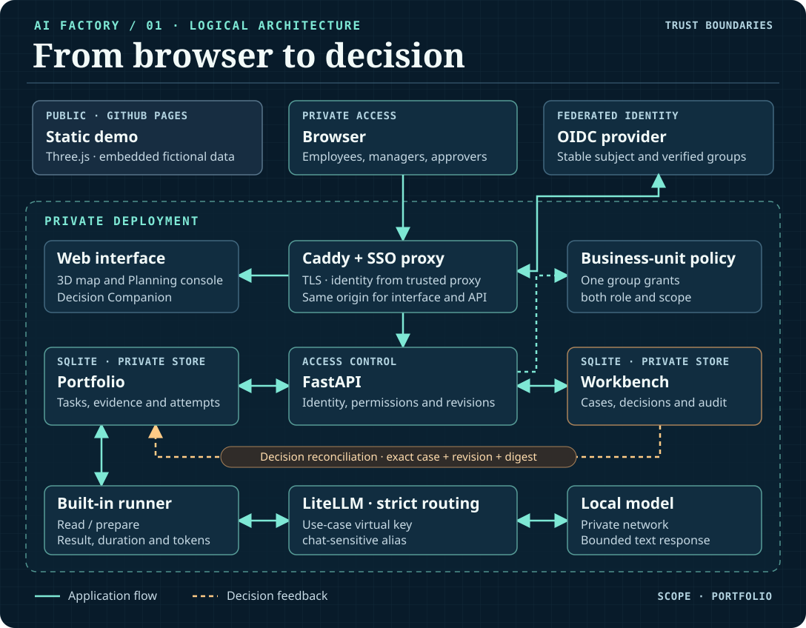
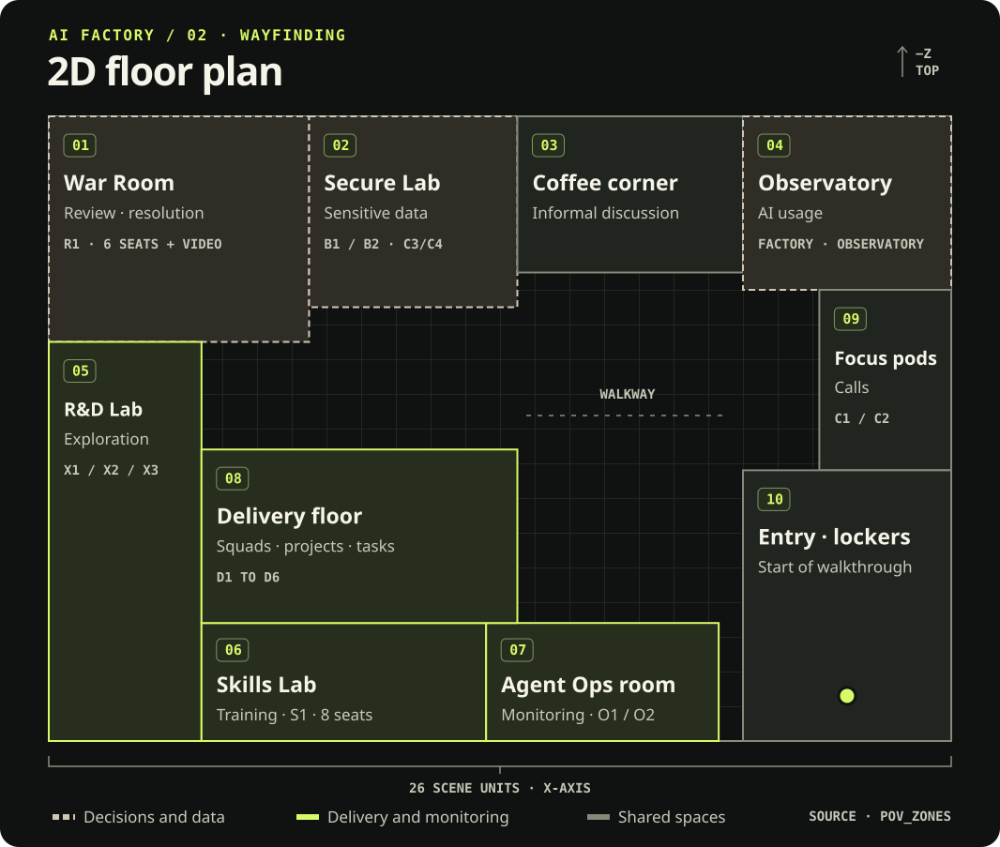

# Architecture

**English** · [Français](fr/ARCHITECTURE.md) · [Technical documentation](README.md)

Virtual AI Factory is generic and published under the MIT license. All demo data is fictional,
and every element (profiles, use cases, catalog, rates, thresholds, regulatory calendar) is
configured in `config/`.

## Deployment and approval paths

The public demo runs from an embedded snapshot. The protected installation uses the SSO edge and
FastAPI to scope portfolio actions to authorized business units, run eligible sub-tasks through
the local model and reconcile a Workbench decision against the exact task revision.
In portfolio mode, Workbench reviews submitted work. CRM and ERP connector actions follow their own
approval flow.

[](../dashboard/docs/media/architecture.en.svg)

## 2D floor plan

The plan shows ten fictional work areas for delivery, technical review, supervision and
collaboration. Production permissions are configured through [business-unit groups and roles](BU_SECURITY.md).

[](../dashboard/docs/media/floor-plan.en.svg)

Open [the interactive architecture page](https://alebgl77.github.io/ai-factory/docs/architecture.en.html)
for the zone details, business-unit matrix and action paths.

## Overview

```text
                 Browser (3D dashboard, no token)
                                │  HTTPS, same origin
                                ▼
                     ┌──────────────────────┐
                     │  edge (Caddy)        │  "VPS proxy": TLS, optional auth,
                     │  {FACTORY_HOST}      │  security headers
                     └───┬──────────┬───────┘
              /          │          │ /api/*
     ┌────────────────┐  │   ┌──────────────────────────────────────────────┐
     │ dashboard      │  │   │ api (FastAPI, MIT): risk, FinOps, pipeline,   │
     │ nginx + Three  │  │   │ data loop, placement, Agent Ops, catalog and  │
     └────────────────┘  │   │ skills engines; deterministic demo            │
                         │   └──┬───────┬────────┬────────┬────────┬────────┘
          grafana.{host} │      │       │        │        │        │
                         ▼      ▼       ▼        ▼        ▼        ▼
                   ┌─────────┐ Grafana Prometheus Langfuse LiteLLM  Qdrant
                   │ Grafana │ (API,   (PromQL)  (public   (health, (health,
                   │ AGPLv3  │ server-           API)     models)  collections)
                   │ separate│ side token)
                   └────┬────┘
                        │ provisioned data sources
                 ┌──────┴───────┐
                 ▼              ▼
            Prometheus        Loki ◄── Alloy (Docker logs)
                 ▲
     ┌───────────┼──────────────┬───────────────────┐
  api /metrics  LiteLLM :9464   DCGM exporter /      Qdrant /metrics
  (factory KPIs) (MIT callback) gpu-sim (telemetry)
                    │
         ┌──────────┼───────────────────────────┐
         ▼          ▼                           ▼
     cloud (keys)  VPS (Ollama, CPU)       local GPU (vLLM)
     chat-default  fallback 1              chat-sensitive, fallback 2
```

## Main flows

1. **Snapshot**: the dashboard calls `GET /api/v1/snapshot?lang=en|fr`. The API aggregates the
   configuration (`config/`), the mutable state (`/data`) and the live sources (Prometheus,
   Grafana, Langfuse, LiteLLM, Qdrant). In `auto` mode, unavailable sources may use the demo
   generator. In `never` mode, the API omits unavailable data. Every localizable string is resolved in
   the requested language (default: `FACTORY_DEFAULT_LANG`, itself `en` by default; see
   [CONTRACT.md](CONTRACT.md), section 9). Opened from `file://`, the dashboard uses the embedded
   demo snapshots, one per language (`scripts/build_snapshot.py`).
2. **Register and risk**: `POST /api/v1/registry/{id}/model-version` records a new model version.
   The risk engine then flags the use case as "reassessment required", and the pipeline's
   deployment gate stays blocked until the review is approved (`POST .../assessment`).
3. **Costs**: the LiteLLM gateway computes the cost of every call. Our MIT callback exposes it as
   Prometheus metrics labeled by use case. The API adds the GPU cost (cloud per hour, local
   amortization + energy), allocates the platform cost (chargeback) and applies the 8 waste rules.
4. **Placement**: every request goes through a gateway alias. `chat-default` goes to the cloud
   first, then to the VPS, then to the local GPU. `chat-sensitive` stays on the local GPU, with no
   fallback.
5. **Grafana**: only the API, server side, queries the Grafana API, with the token of a Viewer
   service account created by `grafana-bootstrap`. The browser only sees aggregated data.

## Decisions and rejected alternatives

| Topic | Choice | Rationale |
|---|---|---|
| LLM gateway | LiteLLM (MIT outside `enterprise/`) + custom Prometheus callback | LiteLLM's native Prometheus metrics are reserved for the Enterprise edition. Apache-2.0 alternatives: Bifrost, TensorZero |
| Langfuse object storage | SeaweedFS (Apache-2.0) | MinIO community images are no longer published since late 2025 |
| Langfuse cache | Valkey (BSD-3) | Avoids the source-available licenses of Redis 7.4 and later |
| Log collection | Grafana Alloy (Apache-2.0) | Promtail reached end of life on March 2, 2026 |
| Vector database | Qdrant (Apache-2.0) | Mature, native Prometheus metrics |
| Three.js | Vendored at build time (`npm pack`, integrity checked) | Works offline on the VPS and allows a strict CSP |
| Retraining | Disabled (`fine_tuning: false`) | The data loop acts through reindexing, evaluation-set updates or routing changes |
| Languages | English first, French second (`?lang=en\|fr`, message catalog `api/app/i18n.py`) | Ids, enums, numbers, dates and metric names never change with the language |

## Docker Compose profiles

| Profile | Content | Use |
|---|---|---|
| *(default)* | edge, dashboard, api, Prometheus, Grafana, Loki, Alloy, Qdrant, LiteLLM, Langfuse and its dependencies | Core stack |
| `sim` | `mock-llm`, `traffic`, `gpu-sim` | Full demo without any key |
| `vps` | `ollama-vps` (CPU), `ollama-vps-pull` | VPS fallback |
| `local-gpu` | `vllm-local`, `vllm-embed`, `dcgm-exporter` | Inference on sensitive data and real rack telemetry |
