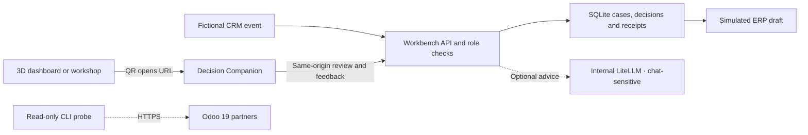

# AI Factory Workbench and Decision Companion

[Français](fr/WORKBENCH.md)

Workbench follows a fictional won CRM opportunity from event intake to a draft ERP order.
It matches the customer, records a proposal for human review and reconciles the simulated
receipt after an interruption. Strategic and undocumented questions enter the same decision
inbox. The mobile companion also lets people ask agents questions and give feedback on a case.

## Open the mobile companion

Select **Decision Companion** or **QR code** in the 3D dashboard or UC-04 workshop. The QR is
generated locally and contains only the companion URL and its `lang` parameter. Sign in
separately when the workspace requires it. To use another device, open the dashboard from a
workspace address that the phone can reach over HTTPS. Local files and `localhost` point to the
device opening them.

| Mode | How to start | Data and access |
|---|---|---|
| Offline browser | Open [the companion HTML file](../dashboard/companion/index.html) directly | Fictional cases, decisions and replies live in the current tab. Reloading starts over. |
| API off | Keep `FACTORY_WORKBENCH_MODE=off`, the default | The workbench API routes are absent. |
| Connected simulation | Set `FACTORY_WORKBENCH_MODE=demo` | Shared fictional cases and ERP drafts in SQLite. Use a controlled environment if authentication is off. |
| Protected simulation | Set `FACTORY_WORKBENCH_MODE=protected_demo` with proxy SSO | The same simulated ERP in an authenticated workspace with role checks. |

The companion supports English and French. The static Pages workflow packages it at the
relative path `companion/` and explicitly selects the isolated browser simulation. The QR
carries no session, credential or case ID. API or authentication failures in an online
workspace are shown in the companion without falling back to a local demo.

Follow the [Compose quick start](../README.md#local-quick-start-no-key-at-all), set the desired
mode in `.env` and run `docker compose --profile sim up -d --build`. The companion is at
`/companion/`. For the protected simulation, follow the [SSO and hardening guide](SECURITY.md),
configure `FACTORY_AUTH=sso`, `FACTORY_AUTH_MODE=proxy` and `FACTORY_ROLE_MAP`, and start the
`sso` profile. Serve the companion and API through the same origin.



## Decisions and agent conversations

- Readers can consult cases and history, ask questions and give feedback. Editors,
  maintainers and admins can submit events. Approvers and admins can decide. Authenticated
  proposers cannot approve their own cases.
- Approval requires a rationale and the exact `revision` and `proposal_hash`. A newer
  proposal invalidates the earlier revision. Initial approval of a proposed action expires
  after seven days. To reconcile a previously recorded approval after a lost response, the
  same approver resubmits the same revision, hash, decision and rationale, even after the
  deadline. A stable action reference lets the sandbox return the existing draft.
- Ambiguous matches and strategic, undocumented or action requests in chat go to a human.
  A recorded decision on a case without a proposed action creates no ERP draft. Pending cases
  take precedence and the priority score incorporates age before the 200-case limit.
- The companion renders case data and replies as text. The API stores cases, decisions,
  receipts and feedback in `workbench-<mode>.sqlite3` under `FACTORY_STATE_DIR`. Escalated
  question text is stored as a shared case. Send only details appropriate for that workspace.
  The workbench does not persist chat transcripts. History exposes feedback totals and your
  own comment. Decision rationales are visible to approvers, admins and their author.

`FACTORY_WORKBENCH_CHAT_MODE=simulation` is the default and uses deterministic replies.
Optional `FACTORY_WORKBENCH_CHAT_MODE=local` requires `protected_demo`, proxy authentication
and the internal LiteLLM gateway. The server selects the fixed `chat-sensitive` alias, applies
C3 metadata, masks inputs and outputs and disables prompt logging for the request. Configure
the local target as shown in the [deployment guide](../README.md#real-deployment-cloud-first-then-vps-then-local-hardware).
The model advises without tools. An unavailable local gateway returns an error. The local
target can itself be simulated under the `sim` profile.

## API and integration contract

Routes below are relative to `/api/v1/workbench`. Browser writes use same-origin JSON.

| Method and path | Behavior |
|---|---|
| `GET /cases` | Read the mode, caller capabilities and prioritized cases with their proposal versions. |
| `POST /events` | Submit the supported CloudEvents 1.0 subset for `crm.opportunity.won` from `crm-sim`. |
| `POST /cases/{id}/decisions` | Submit `approve`, `reject` or `request_changes` with revision, hash and rationale. |
| `GET /cases/{id}/history` | Read the receipt, role-scoped decisions and feedback summary. |
| `POST /cases/{id}/feedback` | Record or replace the caller's `helpful` or `needs_work` rating and optional comment. |
| `POST /chat` | Send a message to `operations`, `finance` or `governance` with an optional `case_id`. |

In the connected local simulation, submit a fictional event and open the companion to review it.

```bash
base=http://localhost/api/v1/workbench
curl -sS "$base/cases"
curl -sS "$base/events" -H 'Content-Type: application/cloudevents+json' -d '{
  "specversion":"1.0","source":"crm-sim","id":"guide-001",
  "type":"crm.opportunity.won","subject":"opp-guide-001",
  "data":{"title":"Guide opportunity","customer_name":"Atelier Acme","customer_ref":"CRM-ACME",
          "amount_minor":124000,"currency":"EUR","record_version":1}
}'
```

The delivery key combines `source` and `id`. An identical retry reuses the case. A changed
payload for the same delivery, stale record version or stale approval returns `409`.
Amounts use integer minor units. Customer matching filters by workspace and allowed record
IDs before comparing exact references or normalized names. It abstains on ambiguous results.
Model routing filters by sensitivity, residency, availability, cost, latency and minimum
quality before scoring. C3 and C4 only admit a local target. The benchmark exercises routing
with synthetic observations. Optional companion advice uses the fixed local alias.

## Read-only Odoo probe and synthetic replay

Install the [API dependencies](../README.md#tests-and-checks). Set `FACTORY_ODOO_URL` to an
HTTPS origin and provide `FACTORY_ODOO_DATABASE` and `FACTORY_ODOO_API_KEY` in the operator
process environment. Use an account restricted to reading from the Odoo 19 JSON-2 API.

```bash
python scripts/workbench_benchmark.py --odoo-read --limit 25
python scripts/workbench_benchmark.py --odoo-read --limit 25 \
  --after-write-date '2026-11-05 12:00:00' --after-id 42 --overlap-seconds 5
```

Replace the sample UTC cursor with the previous output. The command reads one partner page
and prints counts and the next `(write_date, id)` cursor. The limit is 200. The probe performs
no imports or Odoo writes. The synchronization helper commits the checkpoint after applying a
full page. Overlap and interrupted pages can replay records, so the consumer must be
idempotent. Deletions need separate reconciliation.

```bash
python scripts/workbench_benchmark.py
(cd api && python -m pytest -q tests/test_workbench.py tests/test_workbench_algorithms.py)
node tests/e2e/companion.mjs
```

The benchmark replays 36 synthetic cases in SQLite, including duplicate deliveries, lost
receipts, stale approvals and self-approval. It reports 36/36 correct governed outcomes
against 12/36 for a deliberately simple rule, plus 3/3 synthetic routing checks. These outcomes do not measure production
model quality, latency or cost. The browser test uses the locked Playwright setup from
[CI](../.github/workflows/ci.yml).

This implementation covers one shared fictional workspace. The SQLite receipt verifies the
simulated ERP behavior. An external ERP requires its own write and reconciliation contract.
The opt-in Odoo read connector is exercised with a mocked transport in tests.
