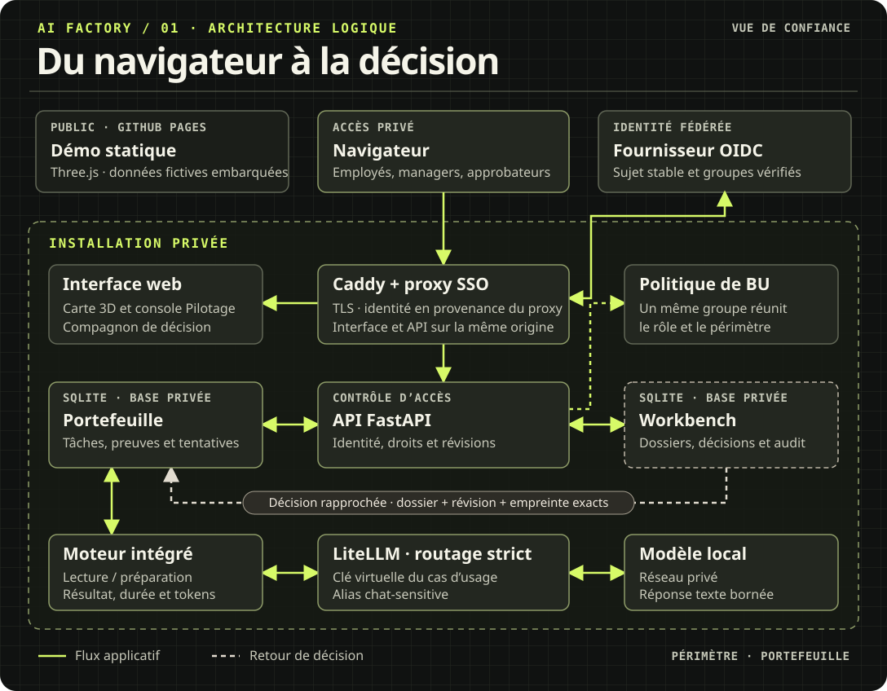
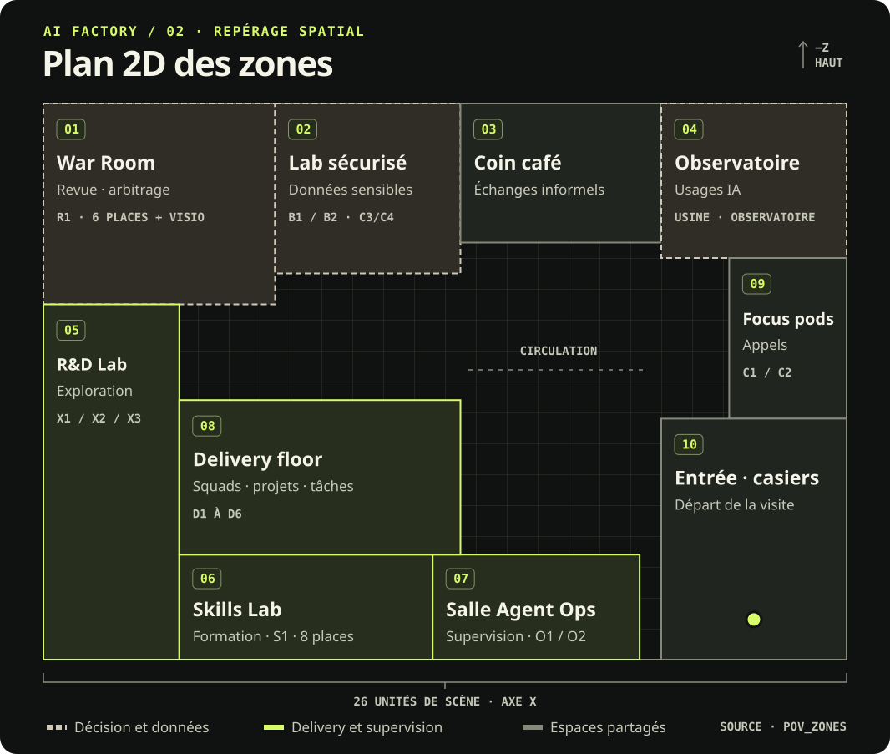

# Architecture

[English](../ARCHITECTURE.md) · **Français** · [Documentation technique](README.md)

Virtual AI Factory, générique et publiable sous licence MIT. Toutes les données de
démonstration sont fictives et chaque élément (profils, use cases, catalogue, tarifs, seuils,
calendrier réglementaire) se configure dans `config/`.

## Déploiement et circuit de décision

La démo publique utilise un jeu de données embarqué. L’installation protégée s’appuie sur le
proxy SSO et FastAPI pour limiter les actions aux BU autorisées, exécuter les sous-tâches
éligibles sur le modèle local et rapprocher la décision Workbench de la révision exacte de la tâche.
En mode portefeuille, le Workbench examine le travail soumis. Les actions des connecteurs CRM
et ERP suivent leur propre circuit d’approbation.

[](../../dashboard/docs/media/architecture.svg)

## Plan 2D

Le plan situe les dix zones fictives de la Factory, dont les espaces de livraison, de revue
technique, de supervision et de collaboration. Les droits de production se configurent dans les
[groupes et rôles par BU](../BU_SECURITY.md).

[](../../dashboard/docs/media/floor-plan.svg)

Ouvrez [le plan interactif](https://alebgl77.github.io/ai-factory/docs/architecture.html) dans un navigateur
pour consulter la fiche de chaque zone, la matrice BU et les circuits d’action.

## Vue d'ensemble

```text
                 Navigateur (dashboard 3D, aucun jeton)
                                │  HTTPS, même origine
                                ▼
                     ┌──────────────────────┐
                     │  edge (Caddy)        │  « proxy du VPS » : TLS, auth optionnelle,
                     │  {FACTORY_HOST}      │  en-têtes de sécurité
                     └───┬──────────┬───────┘
              /          │          │ /api/*
     ┌────────────────┐  │   ┌──────────────────────────────────────────────┐
     │ dashboard      │  │   │ api (FastAPI, MIT) : moteurs risque, FinOps,  │
     │ nginx + Three  │  │   │ pipeline, data loop, placement, Agent Ops,    │
     └────────────────┘  │   │ catalogue, skills ; démo déterministe         │
                         │   └──┬───────┬────────┬────────┬────────┬────────┘
          grafana.{host} │      │       │        │        │        │
                         ▼      ▼       ▼        ▼        ▼        ▼
                   ┌─────────┐ Grafana Prometheus Langfuse LiteLLM  Qdrant
                   │ Grafana │ (API,   (PromQL)  (API     (santé,  (santé,
                   │ AGPLv3  │ jeton             publique) modèles) collections)
                   │ séparé  │ serveur)
                   └────┬────┘
                        │ datasources provisionnées
                 ┌──────┴───────┐
                 ▼              ▼
            Prometheus        Loki ◄── Alloy (logs Docker)
                 ▲
     ┌───────────┼──────────────┬───────────────────┐
  api /metrics  LiteLLM :9464   DCGM exporter /      Qdrant /metrics
  (KPI usine)   (callback MIT)  gpu-sim (télémétrie)
                    │
         ┌──────────┼───────────────────────────┐
         ▼          ▼                           ▼
     cloud (clés)  VPS (ollama CPU)        GPU local (vLLM)
     chat-default  repli 1                 chat-sensitive, repli 2
```

## Flux principaux

1. **Snapshot** : le dashboard appelle `GET /api/v1/snapshot?lang=en|fr`. L'API agrège la configuration
   (`config/`), l'état modifiable (`/data`) et les sources live (Prometheus, Grafana, Langfuse,
   LiteLLM, Qdrant). En mode `auto`, une source indisponible peut utiliser le générateur de démo.
   En mode `never`, l’API omet les données indisponibles. Les textes traduisibles sont rendus dans la langue demandée
   (par défaut `FACTORY_DEFAULT_LANG`, lui-même `en` par défaut ; voir
   [CONTRACT.md](../CONTRACT.md), section 9, en anglais). Ouvert en `file://`, le dashboard utilise
   les snapshots de démo embarqués, un par langue (`scripts/build_snapshot.py`).
2. **Registre et risque** : `POST /api/v1/registry/{id}/model-version` enregistre une nouvelle
   version de modèle. Le moteur de risque passe alors le use case en « réévaluation requise » et le
   gate de déploiement du pipeline est bloqué tant que la revue n'est pas validée
   (`POST .../assessment`).
3. **Coûts** : la passerelle LiteLLM calcule le coût de chaque appel. Notre callback MIT l'expose
   en métriques Prometheus étiquetées par use case. L'API ajoute le coût GPU (cloud à l'heure,
   local amorti + énergie), répartit le coût plateforme (chargeback) et applique les 8 règles de
   gaspillage.
4. **Placement** : chaque requête passe par un alias de la passerelle. `chat-default` va d'abord
   au cloud, puis au VPS, puis au GPU local. `chat-sensitive` reste sur le GPU local, sans repli.
5. **Grafana** : seule l'API, côté serveur, interroge l'API Grafana avec un jeton de compte de
   service Viewer créé par `grafana-bootstrap`. Le navigateur ne voit que des données agrégées.

## Décisions et alternatives écartées

| Sujet | Choix | Raison |
|---|---|---|
| Passerelle LLM | LiteLLM (MIT hors `enterprise/`) + callback Prometheus maison | Les métriques Prometheus natives de LiteLLM sont réservées à l'édition Enterprise. Alternatives sous Apache-2.0 : Bifrost, TensorZero |
| Stockage objet de Langfuse | SeaweedFS (Apache-2.0) | Les images communautaires de MinIO ne sont plus publiées depuis fin 2025 |
| Cache de Langfuse | Valkey (BSD-3) | Évite les licences source-available de Redis 7.4 et suivants |
| Collecte des logs | Grafana Alloy (Apache-2.0) | Promtail est en fin de vie depuis le 2 mars 2026 |
| Base vectorielle | Qdrant (Apache-2.0) | Mature, métriques Prometheus natives |
| Three.js | Vendorisé au build (`npm pack`, intégrité vérifiée) | Fonctionne hors ligne sur le VPS et permet une CSP stricte |
| Réentraînement | Désactivé (`fine_tuning: false`) | La boucle de données agit par réindexation, mise à jour des jeux d'évaluation ou changement de routage |
| Langues | Anglais d'abord, français ensuite (`?lang=en\|fr`, catalogue de messages `api/app/i18n.py`) | Identifiants, énumérations, nombres, dates et noms de métriques ne changent jamais avec la langue |

## Profils Docker Compose

| Profil | Contenu | Usage |
|---|---|---|
| *(défaut)* | edge, dashboard, api, Prometheus, Grafana, Loki, Alloy, Qdrant, LiteLLM, Langfuse et ses dépendances | Socle |
| `sim` | `mock-llm`, `traffic`, `gpu-sim` | Démo complète sans aucune clé |
| `vps` | `ollama-vps` (CPU), `ollama-vps-pull` | Repli VPS |
| `local-gpu` | `vllm-local`, `vllm-embed`, `dcgm-exporter` | Inférence des données sensibles et télémétrie réelle du rack |
