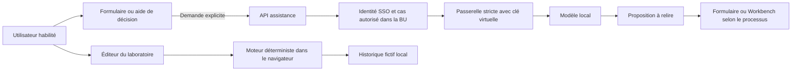

# Assistance contextuelle et Laboratoire de flux IA

[English](../ASSIST_AND_FLOW_LAB.md) · **Français** · [Documentation](README.md)

## 1. Périmètre de la première livraison

L’assistance accompagne trois gestes dans Pilotage et le portefeuille. Elle propose un brouillon pendant la saisie, explique un processus par étapes et prépare une note de décision. Le [Laboratoire de flux](https://alebgl77.github.io/ai-factory/docs/flow-lab.html?lang=fr), accessible depuis le R&D Lab, permet de construire et tester une topologie fictive avec les mêmes concepts de routage, de contrôle et de mesure que la Factory.

| Besoin | Entrée | Résultat vérifiable |
| --- | --- | --- |
| Rédiger une tâche | Titre et éléments choisis dans le formulaire | Proposition éditable et insertion à la demande |
| Comprendre un processus | Contexte et question de l’utilisateur | Étapes, points de contrôle et questions à clarifier |
| Préparer un arbitrage | Administrateur global, sujet, éléments sourcés et choix des sources pour cette analyse | Hypothèses, questions, éléments à vérifier et critères de décision |
| Tester une architecture | Graphe, classes de données et paramètres fictifs | Chemins parcourus, refus, tokens, coût et latence estimés |

## 2. Parcours et règles de décision

1. L’utilisateur ouvre l’aide au niveau de l’action concernée. Il décide quand lancer la proposition et quand l’insérer.
2. La démo présente une aide structurée à partir de règles locales. L’installation privée peut activer l’inférence avec `FACTORY_ASSIST_ENABLED=on`, un proxy SSO, une politique BU et un moteur local configuré.
3. L’API vérifie le périmètre de la demande et la liaison de la clé virtuelle au cas d’usage. L’inférence utilise le modèle local `chat-sensitive` avec un temps et une taille bornés.
4. L’utilisateur relit la proposition. Le formulaire ou le Workbench conserve son propre circuit de soumission et de décision.

La préparation d’une décision exige un groupe SSO qui porte à la fois le rôle d’administrateur et le périmètre global. L’API revérifie la politique et la liaison du modèle avant de rendre le texte. L’interface contrôle la session par une nouvelle requête avant affichage, puis pendant que l’aide privée reste ouverte.

`GET /api/v1/assist` renvoie les périmètres disponibles. `POST /api/v1/assist` lance la suggestion sur demande. [Contrôles de la passerelle](../GATEWAY_SECURITY.md) · [Configuration du moteur](PORTFOLIO.md#moteur-intégré) · [Tests des droits et requêtes](../../api/tests/test_assist.py)

### Analyse de marché

Chaque analyse demande un choix entre **Web public** et **sources internes**. Fournissez les faits déjà établis avec le titre et la date de la source. L’assistance prépare les questions, les hypothèses et les critères de vérification à partir de ces éléments. La collecte, la vérification et la synthèse de résultats obtenus indépendamment nécessitent une intégration distincte. [Feuille de route](https://alebgl77.github.io/ai-factory/docs/roadmap.html?lang=fr)

## 3. Laboratoire de flux IA

### Édition et simulation

- Composer un graphe orienté de composants simulés. La palette contient une source, une passerelle de contrôle, un routeur, un nœud de recherche, des modèles CPU, GPU et distant, et une destination.
- Éditer les nœuds et les liaisons avec une alternative accessible au clavier. Valider les types, les limites, les références et l’absence de cycles avant une exécution.
- Injecter des requêtes fictives par classe de données. Paramétrer leur volume et leurs tokens, choisir un scénario nominal ou mettre un modèle en panne.
- Rejouer le graphe avec les mêmes paramètres et retrouver le même résultat. Une politique de sécurité bloque notamment un flux C3/C4 avant un modèle distant simulé.
- Présenter le nombre de requêtes abouties, bloquées ou en erreur, puis les tentatives et le total de tokens. Expliquer la décision de chaque route et les limites du modèle de coût ou de latence.

### Méthode de calcul

Le lot multiplie les compteurs d’un trajet déterministe par le nombre de demandes. Un nœud de recherche augmente le contexte du modèle simulé. Chaque inférence réussie ajoute ses tokens d’entrée et de sortie. Une panne avant l’inférence augmente le compteur de tentatives et ajoute un délai fictif. Le coût applique un barème par million de tokens, et la latence par demande additionne les délais des étapes et le temps calculé d’après le débit du modèle. Les files d’attente et la concurrence restent hors du modèle.

Avec le graphe d’exemple, le lot nominal de 100 demandes utilise 82 000 tokens estimés. La panne du modèle distant porte le lot à 200 tentatives et le route vers le GPU local. Les tokens estimés restent identiques car le scénario modélise la panne avant l’inférence.

### Historique

L’historique conserve les douze dernières simulations dans le navigateur, avec le graphe, les paramètres fictifs et la version du moteur. L’utilisateur peut rejouer et comparer les résultats. Les entrées utilisent des types connus et des paramètres bornés. L’espace de travail accepte uniquement des paramètres de simulation.

## 4. Frontières techniques

L’inférence privée et le laboratoire suivent deux chemins séparés. La page du laboratoire bloque les connexions sortantes avec sa politique de contenu et utilise des ressources du site. Les modèles, serveurs et flux figurent dans le graphe comme composants simulés. [Directive CSP connect-src](https://developer.mozilla.org/en-US/docs/Web/HTTP/Reference/Headers/Content-Security-Policy/connect-src)

## 5. Recette

| Test | Résultat attendu |
| --- | --- |
| Rejouer une topologie avec la même entrée | Même chemin et mêmes compteurs |
| Envoyer des requêtes C3/C4 vers un modèle distant simulé | Refus visible avant l’inférence simulée |
| Mettre un modèle hors service | Routage alternatif ou échec explicite selon les liaisons |
| Ajouter un cycle ou une liaison invalide | Refus de validation, aucune exécution |
| Revenir sur un résultat | Topologie, scénario, métriques et version accessibles |
| Demander une suggestion et revenir au formulaire | Texte proposé, insertion volontaire, soumission indépendante |
| Changer de session pendant une suggestion privée | Contrôle de la session avant affichage et retrait du résultat devenu inaccessible |
| Préparer deux analyses avec des sources différentes | Provenance distincte et aucune transmission automatique |
| Utiliser un compte hors BU ou désactiver le modèle | Refus de l’appel privé et état compréhensible |
| Ouvrir le laboratoire depuis R&D et l’utiliser au clavier | Accès direct et commandes utilisables sur ordinateur et mobile |

## 6. Ordre de déploiement

Les évolutions et leurs critères de qualification figurent dans la [feuille de route](https://alebgl77.github.io/ai-factory/docs/roadmap.html?lang=fr).
