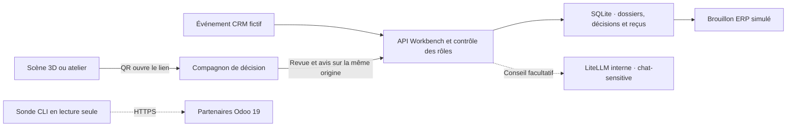

# Workbench AI Factory et Compagnon de décision

[English](../WORKBENCH.md)

Le Workbench suit une opportunité CRM fictive depuis sa réception jusqu’à une commande ERP en
brouillon. Il rapproche le client, soumet la proposition à une personne et retrouve le reçu
simulé en cas d’interruption. Les questions stratégiques ou non documentées rejoignent la même
boîte de décision. Le Compagnon permet aussi de poser des questions aux agents et de donner un
avis sur un dossier.

## Ouvrir le Compagnon sur un téléphone

Sélectionnez **Compagnon de décision** ou **Code QR** dans la scène 3D ou l’atelier UC-04. Le
QR généré localement contient uniquement l’URL du Compagnon et le paramètre `lang`.
Connectez-vous séparément si l’espace l’exige. Pour changer d’appareil, ouvrez la scène depuis
une adresse HTTPS accessible au téléphone. Les fichiers locaux et `localhost` désignent
l’appareil qui les ouvre.

| Mode | Activation | Données et accès |
|---|---|---|
| Navigateur hors ligne | Ouvrir directement [le fichier HTML](../../dashboard/companion/index.html) | Dossiers, décisions et réponses fictifs dans l’onglet courant. Un rechargement réinitialise la session. |
| API désactivée | Conserver `FACTORY_WORKBENCH_MODE=off`, valeur par défaut | Les routes du Workbench sont absentes. |
| Simulation connectée | Définir `FACTORY_WORKBENCH_MODE=demo` | Dossiers fictifs et brouillons ERP partagés dans SQLite. Utiliser en environnement contrôlé si l’authentification est désactivée. |
| Simulation protégée | Définir `FACTORY_WORKBENCH_MODE=protected_demo` avec le proxy SSO | Espace authentifié avec le même ERP simulé et contrôle des rôles. |

Le Compagnon est disponible en français et en anglais. Le workflow Pages le prépare au chemin
relatif `companion/` et sélectionne explicitement la simulation isolée dans le navigateur. Le
QR ne transporte ni session, ni identifiant de dossier, ni secret. En mode connecté, le
Compagnon affiche les erreurs d’API ou d’authentification sans basculer vers la démo locale.

Suivez le [démarrage Compose](../../README.fr.md#démarrage-local-sans-aucune-clé), choisissez le
mode dans `.env`, puis lancez `docker compose --profile sim up -d --build`. Le Compagnon
est à l’adresse `/companion/`. Pour la simulation protégée, suivez le
[guide SSO et durcissement](SECURITY.md). Configurez `FACTORY_AUTH=sso`,
`FACTORY_AUTH_MODE=proxy` et `FACTORY_ROLE_MAP`, puis activez le profil `sso`.
Servez le Compagnon et l’API sur la même origine.



## Décisions et conversations

- Les rôles de lecture peuvent consulter les dossiers et l’historique, poser des questions
  et donner un avis. Les rôles `editor`, `maintainer` et `admin` soumettent les événements.
  Les rôles `approver` et `admin` prennent les décisions. Un utilisateur authentifié ne
  peut pas approuver sa propre proposition.
- Une approbation exige un motif, la `revision` et le `proposal_hash` exacts du dossier.
  Une proposition plus récente invalide la révision précédente. L’approbation initiale
  d’une action expire après sept jours. Pour retrouver le résultat d’une approbation déjà
  enregistrée, le même approbateur renvoie la même révision, la même empreinte, la même
  décision et le même motif, même après l’échéance. Une référence métier stable permet de
  restituer le brouillon existant.
- Un rapprochement ambigu, une question stratégique, une demande non documentée ou une
  demande d’action dans le chat est orientée vers une personne. Consigner une décision sur
  un dossier sans action proposée ne crée aucun brouillon ERP. Les dossiers en attente
  passent en tête et leur ancienneté contribue à leur priorité avant la limite de 200 dossiers.
- Le Compagnon affiche les données et les réponses en texte. L’API conserve les dossiers,
  décisions, reçus et avis dans `workbench-<mode>.sqlite3` sous `FACTORY_STATE_DIR`.
  Une question orientée vers la revue est conservée dans un dossier partagé. Ne saisissez
  que des éléments adaptés à cet espace. Le Workbench ne conserve pas de transcription du
  chat. L’historique affiche les totaux des avis et votre propre commentaire. Les motifs des
  décisions sont visibles par les approbateurs, les administrateurs et leur auteur.

Le mode par défaut `FACTORY_WORKBENCH_CHAT_MODE=simulation` donne des réponses déterministes.
Le mode facultatif `FACTORY_WORKBENCH_CHAT_MODE=local` exige `protected_demo`,
l’authentification par proxy et la passerelle LiteLLM interne. Le serveur choisit l’alias
fixe `chat-sensitive`, marque la requête C3, masque les entrées et sorties et désactive la
journalisation du prompt pour cette requête. Configurez la cible locale en suivant
[le guide de déploiement](../../README.fr.md#déploiement-réel--cloud-dabord-puis-vps-puis-matériel-local). Le modèle donne un avis sans outil.
L’indisponibilité de la passerelle locale produit une erreur. Le profil `sim` peut aussi
simuler la cible locale.

## API et contrat d’intégration

Les routes sont relatives à `/api/v1/workbench`. Le navigateur écrit en JSON sur la même origine.

| Méthode et route | Comportement |
|---|---|
| `GET /cases` | Retourne le mode, les capacités de l’utilisateur et les dossiers priorisés avec leur révision et leur empreinte. |
| `POST /events` | Reçoit le sous-ensemble CloudEvents 1.0 pris en charge pour `crm.opportunity.won` depuis `crm-sim`. |
| `POST /cases/{id}/decisions` | Accepte `approve`, `reject` ou `request_changes` avec révision, empreinte et motif. |
| `GET /cases/{id}/history` | Retourne le reçu, les décisions visibles selon le rôle et le résumé des avis. |
| `POST /cases/{id}/feedback` | Enregistre ou remplace l’avis `helpful` ou `needs_work` de l’utilisateur et son commentaire facultatif. |
| `POST /chat` | Accepte un agent `operations`, `finance` ou `governance`, un message et un `case_id` facultatif. |

Dans la simulation connectée en local, envoyez un événement fictif puis ouvrez le Compagnon
pour examiner le dossier.

```bash
base=http://localhost/api/v1/workbench
curl -sS "$base/cases"
curl -sS "$base/events" -H 'Content-Type: application/cloudevents+json' -d '{
  "specversion":"1.0","source":"crm-sim","id":"guide-fr-001",
  "type":"crm.opportunity.won","subject":"opp-guide-fr-001",
  "data":{"title":"Opportunité de démonstration","customer_name":"Atelier Acme","customer_ref":"CRM-ACME",
          "amount_minor":124000,"currency":"EUR","record_version":1}
}'
```

La clé de livraison combine `source` et `id`. Un renvoi identique réutilise le dossier.
Un contenu différent pour la même livraison, une version obsolète ou une approbation
périmée reçoit `409`. Les montants utilisent des unités monétaires mineures entières. Le
rapprochement filtre selon l’espace et les identifiants autorisés, puis compare les références
exactes ou les noms normalisés. Il s’abstient si le résultat est ambigu. Le routage filtre
selon la sensibilité, la résidence, la disponibilité, le coût, la latence et la qualité
minimale avant de calculer un score. Les classes C3 et C4 exigent une cible locale. Le
benchmark exerce ce routage avec des observations fictives. Le Compagnon utilise son alias
local fixe pour le conseil facultatif.

## Sonde Odoo en lecture seule et rejeu synthétique

Installez les [dépendances de l’API](../../README.fr.md#tests-et-vérifications), puis configurez `FACTORY_ODOO_URL`
avec une origine HTTPS et fournissez `FACTORY_ODOO_DATABASE` et `FACTORY_ODOO_API_KEY` dans
l’environnement du processus opérateur. Utilisez un compte limité à la lecture pour l’API
JSON-2 d’Odoo 19.

```bash
python scripts/workbench_benchmark.py --odoo-read --limit 25
python scripts/workbench_benchmark.py --odoo-read --limit 25 \
  --after-write-date '2026-11-05 12:00:00' --after-id 42 --overlap-seconds 5
```

Remplacez le curseur UTC d’exemple par la valeur de la sortie précédente. La commande lit
une page de partenaires et affiche le compteur et le prochain curseur `(write_date, id)`.
La limite est de 200. La sonde ne réalise aucun import ni écriture dans Odoo. La fonction de
synchronisation enregistre le curseur après traitement de la page entière. Le recouvrement
et une interruption de traitement peuvent rejouer des lignes. Le consommateur doit donc être
idempotent. Les suppressions exigent une réconciliation séparée.

```bash
python scripts/workbench_benchmark.py
(cd api && python -m pytest -q tests/test_workbench.py tests/test_workbench_algorithms.py)
node tests/e2e/companion.mjs
```

Le benchmark rejoue 36 cas synthétiques dans SQLite, dont les livraisons dupliquées, la perte
de reçu, les approbations obsolètes et l’autoapprobation. Il comprend aussi trois vérifications
de routage synthétiques, toutes réussies. Le scénario gouverné obtient 36/36 résultats
attendus, contre 12/36 pour une règle volontairement simple.
Ces résultats ne mesurent ni la qualité des modèles en production, ni la latence, ni le coût.
Le test navigateur utilise la même installation Playwright verrouillée que
[la CI](../../.github/workflows/ci.yml).

L’implémentation couvre un seul espace fictif partagé. Le reçu SQLite vérifie le comportement
de l’ERP simulé. Un ERP externe demande son propre contrat d’écriture et de réconciliation.
La lecture Odoo est facultative et le connecteur est testé avec un transport simulé.
